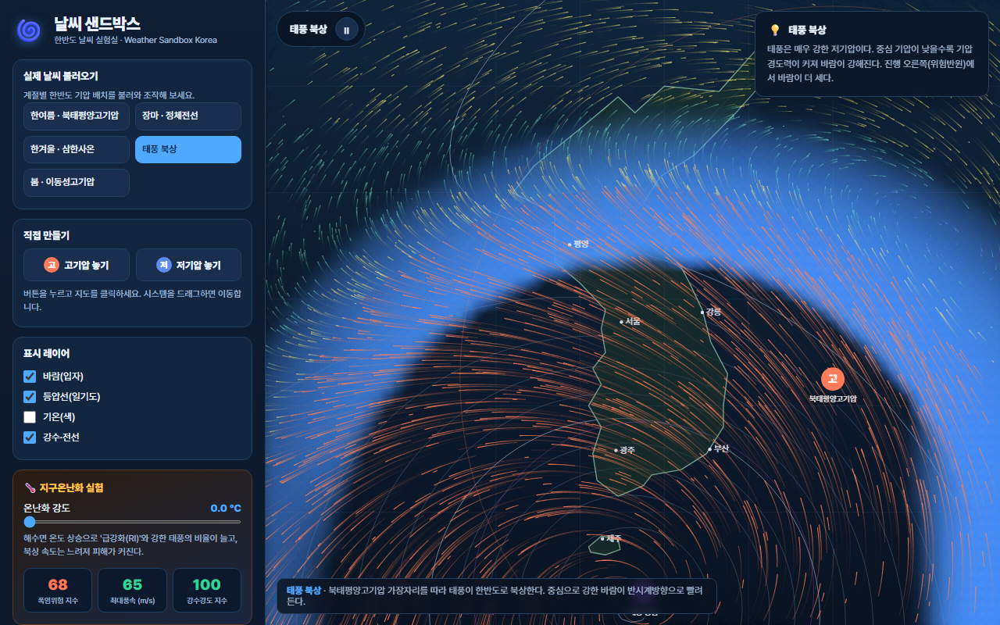

# 🌀 날씨 샌드박스 (Weather Sandbox Korea)

**기압을 직접 움직여 한반도 날씨를 만드는 인터랙티브 학습 도구**

기상·기후 AI 해커톤(기상청 기상기후인재개발원, 2026) 출품작.
고기압·저기압을 손으로 끌어다 놓으면 기압경도력과 전향력으로 계산된 바람장을 따라 수천 개의 입자가 실시간으로 흐릅니다. "읽는 기상학"이 아니라 **"조작하는 기상학"**.



## ▶ 실행 방법

설치·빌드·서버가 **전혀 필요 없습니다.**

```
1. 이 폴더의 index.html 을 더블클릭 (또는 브라우저로 열기)
2. 끝.
```

또는 정적 호스팅에 올려 공개 URL로 배포:

```bash
# GitHub Pages: 저장소 Settings → Pages → main 브랜치 / root
# Netlify·Vercel: 이 폴더를 드래그&드롭
```

## 🎮 사용법

| 기능 | 방법 |
|---|---|
| 실제 계절 날씨 불러오기 | 좌측 **프리셋** 5종 클릭 (한여름·장마·한겨울·태풍·봄) |
| 기압계 직접 만들기 | **고/저기압 놓기** → 지도 클릭 |
| 이동·조절 | 기압계를 드래그 / 슬라이더로 강도·크기·기온 조절 |
| 표시 전환 | 바람·등압선·기온·강수 레이어 토글 |
| 기후변화 실험 | **지구온난화 슬라이더** → 폭염·강수·풍속 지표 관찰 |
| 학습 | 우측 개념 카드 + 🎓 학습 퀴즈 |

## 🧪 작동 원리 (교육용 모델)

- **기압장** : 각 기압계를 가우시안 편차의 합으로 모델링 (고기압 +, 저기압 −)
- **바람장** : 지균풍 = 기압경도력을 전향력으로 90° 회전 → 북반구 저기압=반시계 수렴, 고기압=시계 발산. 마찰 유입각으로 수렴/발산 구현. 전향력은 위도 sin φ 의존.
- **강수·전선** : 바람 수렴(발산의 음수) × 수증기량(기온)으로 강수강도 산출 → 기단 충돌 경계에 강수대 형성
- **풍속 상한** : 현실 최대치 ~65 m/s

> 정량적 정밀 예보 모델이 아니라, 원리의 인과관계를 **정성적으로 정확하게** 체감시키는 학습용 시뮬레이터입니다.

## 🗂 구조

```
index.html        # 단일 페이지 앱
assets/style.css  # 스타일 (다크 테마, 반응형)
assets/data.js    # 한반도 해안선·도시·기상 프리셋·개념카드 (내장 데이터)
assets/app.js     # 시뮬레이션 엔진(기압→바람→입자) + 등압선 + UI + 퀴즈
docs/개발계획서.md  # 서류심사용 개발계획서
```

## 🛠 기술 스택

순수 **HTML + CSS + Vanilla JavaScript + Canvas 2D**. 프레임워크·빌드·외부 API·백엔드 **없음**. 모든 데이터 내장 → 어디서나 즉시 실행, 오프라인 동작, 모바일 지원.

## 📊 데이터 출처

계절별 기압배치 프리셋은 기상청 기상자료개방포털(data.kma.go.kr)과 평년 일기도를 근거로 모델링했습니다.

---
© 2026 기상·기후 AI 해커톤 출품작 · 교육 목적
