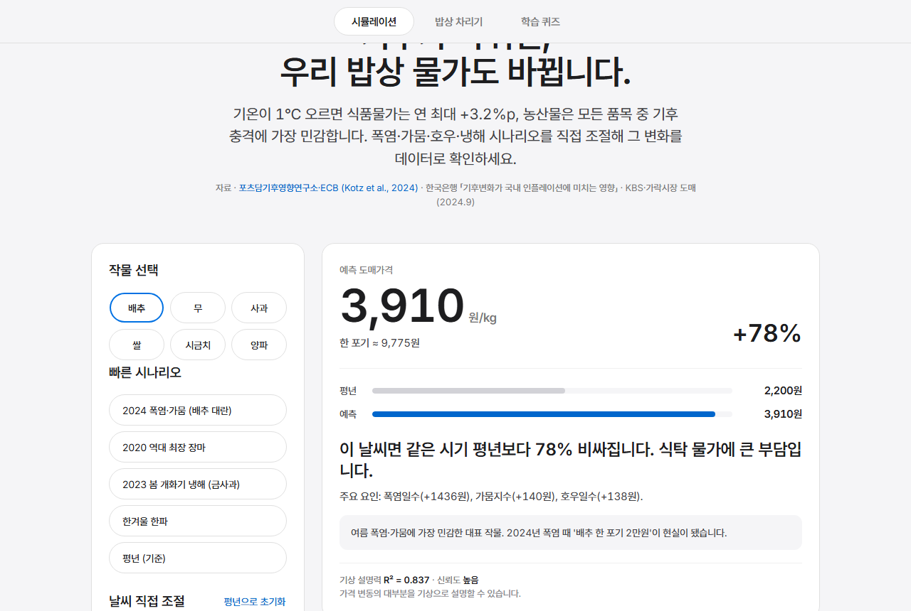
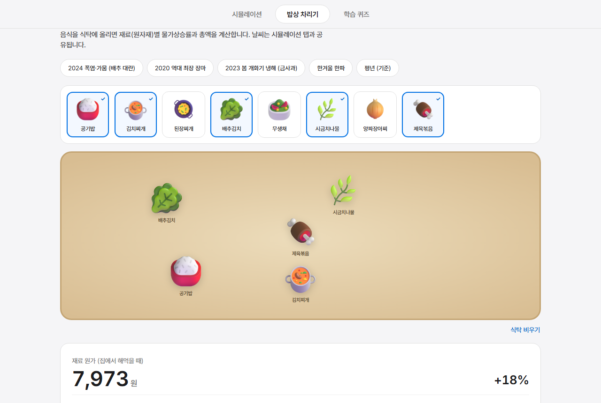
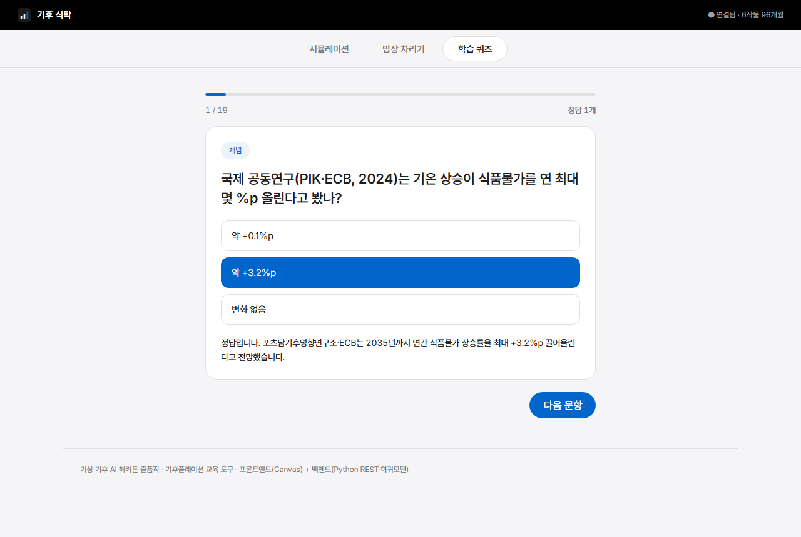

# 기후 식탁 (Climate Table) — 전체 시스템 개발 계획서

문서 종류: 시스템 개발 계획서 (System Development Plan)
대상: 기상·기후 AI 해커톤 출품작 "기후 식탁"
작성일: 2026-06-26
상태 범례: ✅ 완료 · 🔨 진행 중 · 🔜 예정

---

## 1. 프로젝트 개요

### 1.1 제품 정의
폭염·가뭄·호우·한파·개화기 냉해 시나리오를 직접 조작하면, 백엔드 회귀모델이
농산물(배추·무·사과·쌀·시금치·양파) 가격을 실시간 예측하는 **인터랙티브
기후플레이션 교육 웹앱**. "기후변화가 위험하다"는 추상적 경고를 "내 장바구니·
밥상이 얼마나 오르는가"라는 체감으로 전환한다.

### 1.2 목표
- 기상 → 작황 → 공급 → 가격의 인과를 사용자가 직접 조작·검증하게 한다.
- 기후플레이션·식량안보·적응전략을 능동 학습시킨다.
- 설치·로그인·외부 의존성 없이 어디서나 즉시 실행된다.

### 1.3 대상 사용자
학생(통합과학·사회·경제 융합수업), 교사(무설치 수업 도구), 일반 시민.

### 1.4 핵심 원칙
- **의존성 0**: Python 표준 라이브러리 + Vanilla JS만. CDN/패키지/DB/API키 없음.
- **0% 오류**: 매 변경마다 자동 검증(test_api.py) + 프론트 콘솔 에러 0.
- **교육적 정확성**: 정밀 시세 예측이 아니라 인과를 정성적으로 정확히 전달.

---

## 2. 시스템 아키텍처

### 2.1 실제 동작 화면

세 개의 탭으로 "조작 → 예측 → 이해 → 밥상 체감 → 학습"의 흐름을 구성한다.
아래는 로컬 서버(`python backend/app.py`)에서 직접 캡처한 실제 화면이다.

**① 시뮬레이션 탭 — 날씨를 직접 조작하면 농산물 가격이 실시간 예측된다**



*▲ 2024 폭염·가뭄 프리셋: 배추 도매가 +78% 예측, 기여 요인·신뢰도(R²) 즉시 표시. 하단에 지역별 영향 지도·과거 추이 차트·기상-가격 상관 막대·적응 방안 제공*

**② 밥상 차리기 탭 — 음식을 식탁에 올리면 재료 원가 vs 외식가가 계산된다**



*▲ 음식을 식탁에 올리면 재료 원가(7,973원, +18%)와 외식가를 동시 계산. 하단에 음식별·원자재별 가격 영향과 구매단위 가격 제공*

**③ 학습 퀴즈 탭 — 5개 분야 문항으로 즉시 피드백 학습**



*▲ 문항에 답하면 정답 여부와 근거 해설이 즉시 표시(출처 포함). 5개 분야 + 예측 챌린지*

### 2.2 구성도(데이터 흐름)

```
브라우저(frontend/)  ──fetch /api/* (동일 출처)──▶  백엔드(backend/app.py)  ──▶  도메인(model.py·dishes.py)  ──▶  데이터(data/)
  탭1 시뮬레이션                                       Python http.server         릿지 회귀·밥상 원가 계산        dataset.json(96개월)
  탭2 밥상 차리기                                      라우팅·응답 조립                                            gen_data.py(실사건 보정)
  탭3 학습 퀴즈                                        정적 서빙(frontend·assets)
```

| 계층 | 파일 | 책임 |
|---|---|---|
| 프레젠테이션 | `frontend/`(index.html·app.js·style.css) | 입력·시각화·상호작용. 계산은 하지 않고 API 호출 |
| 애플리케이션 | `backend/app.py` | 라우팅·시나리오 파싱·응답 조립·정적 서빙 |
| 도메인 | `backend/model.py`, `backend/dishes.py` | 회귀 예측·가격 계산(순수 함수 중심) |
| 데이터 | `backend/data/`(dataset.json·gen_data.py) | 정적 데이터셋 + 재현 가능한 생성기 |

설계 원칙: 프레젠테이션은 계산하지 않고 API만 호출하고, 도메인은 순수 함수로
유지해 검증과 재현이 쉽도록 한다. 모든 통신은 동일 출처 `fetch /api/*`이며 외부
CDN·패키지·DB·API 키 의존이 0이다.

---

## 3. 기술 스택

| 영역 | 기술 | 비고 |
|---|---|---|
| 백엔드 | Python 3.8+ `http.server`, `ThreadingHTTPServer` | 표준 라이브러리만 |
| 모델 | 순수 파이썬 릿지 회귀(정규방정식·가우스 소거) | 외부 ML 라이브러리 0 |
| 프론트 | Vanilla JS(IIFE), HTML5, CSS | 프레임워크·번들러 0 |
| 시각화 | Canvas 2D 직접 렌더(차트·지도) | 차트 라이브러리 0 |
| 폰트 | Inter(라틴/숫자) + Pretendard(한글) | 디자인 토큰화 |
| 에셋 | Microsoft Fluent Emoji 3D (MIT) | 로컬 번들, 이모지 폴백 |
| 검증 | `backend/test_api.py`(통합 테스트) | 별도 러너 불필요 |

실행: `python backend/app.py` → `http://localhost:8000`

---

## 4. 기능 명세 (전체)

### 4.1 기능 맵
| ID | 기능 | 위치 | 상태 |
|---|---|---|---|
| C1 | 작물 선택(6종) | 시뮬레이션 | ✅ |
| C2 | 날씨 슬라이더(폭염·호우·가뭄·한파·냉해·월) | 시뮬레이션 | ✅ |
| C3 | 빠른 프리셋(2024 폭염·2020 장마·2023 냉해·한파·평년) | 시뮬레이션 | ✅ |
| C4 | 실시간 예측 + 평년比% + 기여 요인 분해 | 시뮬레이션 | ✅ |
| C5 | 회귀 신뢰도(R² 등급) 표시 | 시뮬레이션 | ✅ |
| C6 | 적응·해결 방안 패널 | 시뮬레이션 | ✅ |
| C7 | 과거 가격 추이 차트 + 기상 사건 마커(Canvas) | 시뮬레이션 | ✅ |
| C8 | 기상-가격 상관관계 막대 | 시뮬레이션 | ✅ |
| C9 | 지역별 영향 지도(주요 산지·Canvas) | 시뮬레이션 | ✅ |
| M1 | 음식 드래그&드롭 식탁 구성 | 밥상 차리기 | ✅ |
| M2 | 재료(원자재) 물가상승률 + 밥상 총액 | 밥상 차리기 | ✅ |
| M3 | 3D 음식 아이콘(이모지 폴백) | 밥상 차리기 | ✅ |
| M4 | 날씨 시나리오 공유(시뮬↔밥상) | 밥상 차리기 | ✅ |
| M5 | **재료 원가 vs 사먹을 때(외식) 2종 표시** | 밥상 차리기 | 🔨 |
| M6 | **소비자 구매단위(포기·망·개·단·포대) 가격** | 밥상 차리기 | 🔨 |
| Q1 | 분야별 퀴즈(개념·사례·대응·데이터·정책 18문항) | 학습 퀴즈 | ✅ |
| Q2 | 예측 챌린지(모델로 정답 확인) | 학습 퀴즈 | ✅ |
| Q3 | 분야 선택·진행률·분야별 채점·결과 등급 | 학습 퀴즈 | ✅ |
| X1 | 반응형(모바일) + 로딩/에러 토스트 | 전역 | ✅ |
| X2 | 접근성(aria-live·aria-label) | 전역 | ✅ |

### 4.2 핵심 기능 상세

**시뮬레이션 루프(C1~C4)**: 조작(Manipulate) → 예측(Predict) → 이해(Explain).
슬라이더 입력 → 110ms 디바운스 → `POST /api/simulate` → 예측가·평년比%·
기여 요인·해설·신뢰도·적응전략을 결과 카드와 차트에 갱신.

**날씨 효과 분리(C4)**: 예측을 "같은 시기 평년 기상" 기준과 비교해 계절 효과를
제거하고 날씨가 만든 변동만 보여준다(귀속 정확성).

**지역별 영향 지도(C9)**: 남한 외곽선 + 작물별 주요 산지를 Canvas에 그리고,
현재 시나리오의 가격압력을 원 크기·농도로 시각화(겹침 분리 알고리즘 포함).

**밥상 차리기(M1~M6)**: 음식을 식탁에 드래그(모바일은 탭) → `POST /api/meal` →
음식별·재료별 가격·총액 표시. 진행 중인 M5·M6은 별도 개발 계획서
(`docs/superpowers/specs/2026-06-26-meal-cost-vs-eatout-devspec.md`) 참조.

**학습 퀴즈(Q1~Q3)**: `GET /api/quiz`의 18문항(5분야) + 예측 챌린지. 분야 선택,
진행률 바, 분야별 채점, 결과 등급(마스터/우수/보통/복습).

---

## 5. 데이터 모델

### 5.1 데이터셋 (dataset.json)
- 2018~2025 **월별 96개월**. 각 행: 날짜·월·기상 피처·작물별 가격.
- 기상 피처: 폭염일수·한파일수·호우일수·가뭄지수·개화기냉해·일조시간.
- 기상청 기상자료개방포털·KAMIS·통계청 보도값과 실제 기후사건으로 보정.
- 재현 생성기 `gen_data.py`(실사건 2-pass 전파: 봄 냉해 → 이듬해 사과).

### 5.2 음식 카탈로그 (dishes.py)
- 음식 8종 = 기후 재료(6작물, 분량 kg) + 고정 재료(고기·두부·양념, 정가).
- M5·M6에서 구매단위(UNITS)·외식 단가(eatout) 추가 예정.

---

## 6. 회귀모델 (model.py)

- **모델**: 작물별 릿지 선형회귀. 설계행렬 = [1, 기상 피처 6, sin(월), cos(월)].
  정규방정식 (AᵀA + λI)x = Aᵀb 를 가우스 소거로 해. λ=18(다중공선성 억제).
- **피처**: heat_days, cold_days, heavy_rain_days, drought_idx, frost, sun_dev.
  계절성은 월의 sin/cos로 반영.
- **출력**: `predict`(예측가), `contributions`(피처별 기여액),
  `correlations`(피어슨 상관), `reliability`(R² 등급), `series`(시계열).
- **설명력(R², PROGRESS 기준)**: 배추 0.86 · 무 0.83 · 사과 0.79 · 시금치 0.43 ·
  양파 0.42 · 쌀 0.12(낮음 — 정부 비축·수급관리로 기상 영향 작음, 교육 포인트).
- **재현 사례**: 폭염·가뭄 → 배추 급등 / 봄 개화기 냉해 → 사과('금사과') 상승.

---

## 7. API 명세 (전체)

| 메서드 | 경로 | 설명 |
|---|---|---|
| GET | /api/health | 상태·작물 수·개월·데이터 출처 |
| GET | /api/items | 작물 목록·평년값·기상 사건·피처 |
| GET | /api/series?item= | 작물 월별 시계열·평년·R² |
| GET | /api/correlate?item= | 피처별 상관계수 |
| GET | /api/model?item= | 회귀계수·R²·신뢰도 |
| GET | /api/quiz | 학습 퀴즈 문항 |
| GET | /api/dishes | 음식 카탈로그(+ M5·M6: units·eatout) |
| POST | /api/simulate | 시나리오 → 예측·기여·해설·신뢰도·적응 |
| POST | /api/meal | 밥상 음식 목록 → 음식·재료 가격·총액 |

공통: JSON 응답, CORS 허용, 정적 파일(frontend/·assets/) 안전 경로 서빙.

---

## 8. 프론트엔드 설계

### 8.1 구조
- 단일 `app.js`(IIFE), `index.html`(3탭), `style.css`(디자인 토큰).
- 상태 객체 `state`(scenario·items·series·dishes·meal 등) 중심, 함수형 렌더.
- 탭: 시뮬레이션 / 밥상 차리기 / 학습 퀴즈(세그먼트 컨트롤).

### 8.2 시각화
- 차트·지도 모두 Canvas 2D 직접 렌더(DPR 대응, 리사이즈 재그리기).
- 라이브러리 의존 0 → 오프라인·경량.

### 8.3 디자인 시스템
- Apple 디자인 언어: 단일 Action Blue(#0066cc), 헤어라인 카드(그림자 없음),
  음수 자간 디스플레이, 알약 CTA, scale(.95) 프레스.
- 폰트: Inter(라틴·숫자) + Pretendard(한글 폴백). 디자인 토큰은 `:root` 변수.

---

## 9. 개발 로드맵

### 9.1 Phase 1 — 베이스라인 풀스택 ✅
T0~T10: 데이터 생성기·백엔드 스켈레톤·데이터 로딩·회귀모델·simulate·프론트·
Canvas 차트·퀴즈·적응 패널·반응형/에러처리.

### 9.2 Phase 2 — 정확성·신뢰성 ✅
- T11 통합 검증(test_api) · T14 신뢰도 등급화 · T15 날씨 효과 분리(평년 기준)
- T16 사과 봄냉해 연중 전파('금사과') · T17 접근성·가계 단위 환산
- 실데이터 대조 보정(KAMIS/가락시장/보도값).

### 9.3 Phase 3 — 확장 기능 ✅
- 지역별 영향 지도(주요 산지 Canvas) · 폰트 Inter+Pretendard 교체
- 퀴즈 분야별 확충(18문항·5분야 + 예측 챌린지)
- 밥상 차리기(드래그&드롭·3D 아이콘·원가·날씨 공유).

### 9.4 Phase 4 — 밥상 고도화 🔨 (현재)
- M5 재료 원가 vs 사먹을 때(외식) 2종 표시
- M6 소비자 구매단위(포기·망·개·단·포대) 가격
- 상세: `docs/superpowers/specs/2026-06-26-meal-cost-vs-eatout-devspec.md`
- 작업: dishes.py 데이터 → compute_meal 확장 → 프론트 렌더 → 스타일 → 검증.

### 9.5 Phase 5 — 실데이터 연동 🔜
- 기상청 기상자료개방포털·KAMIS OpenAPI 실데이터(정적 캐시 방식, 의존성 0 유지).
- 작물·지역 확대, 교사·전문가 피드백 반영.

### 9.6 대회 마일스톤
| 기간 | 작업 |
|---|---|
| ~7.3 접수 | 계획서 + 작동 프로토타입 제출 ✅ |
| 7.23~8.7 사전개발 | 실데이터 연동·밥상 고도화·작물/지역 확대 |
| 8.10~8.12 중간점검 | 교사·전문가 피드백, 퀴즈·해설 강화 |
| 8.21~22 본선 | 라이브 데모 리허설, 성능 최적화 |

---

## 10. 테스트·검증 전략

- **백엔드 자동**: `python backend/test_api.py` — 전 엔드포인트·경계값·에러처리.
  현재 29/29 통과(밥상 추가 후). 매 변경 시 0 에러 확인.
- **프론트 수동 QA**: 브라우저로 탭 전환·드래그·프리셋·날씨 공유·이미지 폴백·
  콘솔 에러 0·모바일(≤833px) 점검.
- **회귀 방지**: 기존 기능(시뮬·퀴즈) 동작 불변을 매 작업 검토.
- **개발 방식**: 작업 단위 분해 → 구현 → 스펙/품질 리뷰 → 통합 리뷰(서브에이전트
  주도). 작은 원자적 커밋.

---

## 11. 배포·운영

- 단일 명령 `python backend/app.py`로 기동(백엔드가 프론트 정적 서빙).
- 클라우드 무료 티어·사내 서버·로컬 어디서나 동작. 설치 실패·CORS·키 노출·
  서버비용 리스크가 구조적으로 없음.

---

## 12. 리스크 관리

| 리스크 | 영향 | 대응 |
|---|---|---|
| 데이터 정확성 논란 | 신뢰도 | "교육용 근사 모델" 명시, 인과 방향성 실제 일치, 실데이터 로드맵 |
| 다중공선성(겨울 계절성↔한파) | 귀속 오류 | 릿지 정규화 + 평년 기상 기준 비교(반영 완료) |
| 모델 과신 | 오해 | R²·신뢰도 등급 투명 공개 |
| 에셋 라이선스 | 배포 | 무료 MIT(Fluent Emoji) + 출처 CREDITS + 이모지 폴백 |
| API 응답 스키마 변경(M5) | 프론트 회귀 | 백엔드·프론트 동시 수정 + 테스트로 보증 |

---

## 13. 산출물 목록

- 백엔드: `app.py` · `model.py` · `dishes.py` · `test_api.py` · `data/`
- 프론트: `frontend/`(index.html · app.js · style.css) · `frontend/assets/`(3D 아이콘·CREDITS)
- 문서: 본 계획서 · `개발계획서.md`(심사 루브릭) · 밥상 설계/계획 스펙 · README · DESIGN.md
- 검증: `test_api.py`(29/29)

> 날씨를 바꿔보고, 가격을 확인하고, 밥상을 차려보고, 대응을 배운다.
> 기후 식탁은 기후위기 교육을 공포에서 이해와 행동으로 옮긴다.
